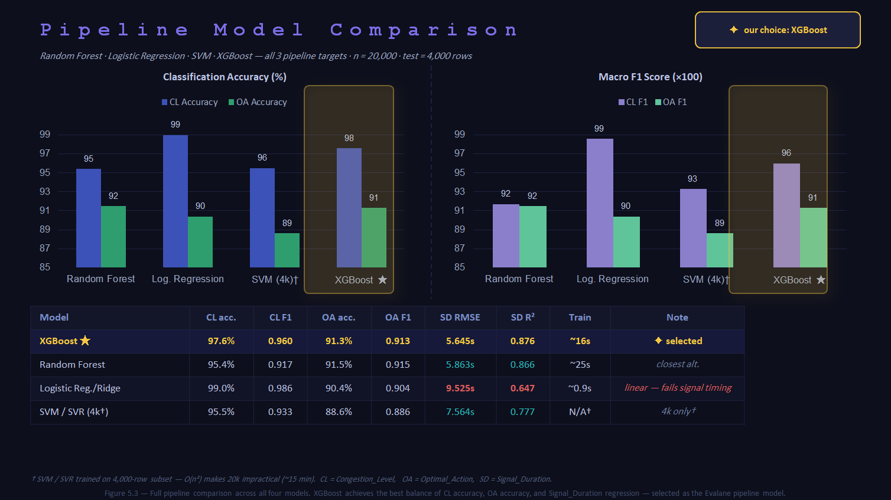
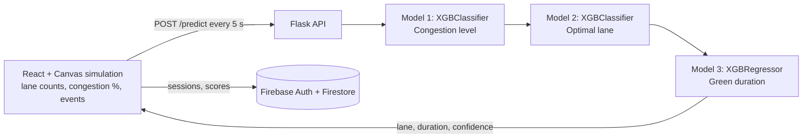

# Evalane: AI Traffic Signal Optimization & Officer Training Simulator

Evalane is a web-based simulator of a four-way intersection that teaches traffic officers to choose which lane gets the green light. A chain of three XGBoost models reads the live state of the junction and recommends **which lane to open** and **for how long**. The trainee's own decisions are scored against that recommendation.

Graduation project, BSc in Data Science and Artificial Intelligence, Mutah University (2026).



## How it works



**The simulator** (`frontend/`) draws a junction with three incoming lanes per approach, animated cars, and ambulance events. The officer picks which lane to open. Each decision that matches the AI recommendation adds 10 points, and each one that doesn't removes 5. At the end of a timed session the score, correct decisions and average congestion are saved to Firestore, and the previous score is shown next time.

**The models** (`backend/evalane_sim_pipeline.py`) form a chain. Each stage receives the previous stage's prediction as an extra input.

| Stage | Model | Predicts |
|---|---|---|
| 1 | `XGBClassifier` | Congestion level: Low / Moderate / High / Severe |
| 2 | `XGBClassifier` | Optimal action: `GREEN_N` / `GREEN_S` / `GREEN_E` / `GREEN_W` |
| 3 | `XGBRegressor` | Green duration in seconds (clipped to 12–83), with a ±1 RMSE range |

Inputs (12 features): vehicle count and congestion % for each lane, the current green lane, seconds left on the current green, and the event type and lane (`Normal` / `Ambulance` / `Breakdown`). If an ambulance is present, its lane is always forced to green and the duration is floored at 35 s.

## Results

Evaluated on a held-out 20% split (4,000 rows) of the 20,000-row dataset:

| Target | Metric | Result |
|---|---|---|
| Congestion level | Accuracy / macro F1 | 97.6% / 0.96 |
| Optimal lane | Accuracy / macro F1 | 91.3% / 0.91 |
| Green duration | RMSE / R² | 5.6 s / 0.88 |

Model comparison (`ml/evalane_comparison.py`, same split and preprocessing for every model):

| Model | Congestion acc. | Lane acc. | Duration RMSE | Duration R² |
|---|---|---|---|---|
| **XGBoost (selected)** | 97.6% | 91.3% | 5.65 s | 0.876 |
| Random Forest | 95.4% | 91.5% | 5.86 s | 0.866 |
| Logistic / Ridge Regression | 99.0% | 90.4% | 9.53 s | 0.647 |
| SVM / SVR (4,000-row subset) | 95.5% | 88.6% | 7.56 s | 0.777 |

The table comes from the project presentation. The script also tests LightGBM, which scores within about 0.2 points of XGBoost on both classification targets. XGBoost was chosen for the best balance across all three targets, not the best single score. Logistic regression is slightly better at congestion level but much worse at duration. A grid search (`GridSearchCV`) did not improve on the default hyperparameters (90.9% vs 90.8% lane accuracy when re-run).

## Repository layout

```
backend/    Flask API, the chained pipeline class/training script, trained model (.pkl)
ml/         Dataset generator and the multi-model comparison + tuning script
data/       evalane_sim_dataset_v2.csv (20,000 rows x 15 columns)
frontend/   React pages (landing, login/register, simulation) and Firebase config
docs/       Figures
```

## Run it locally

**API**

```bash
cd backend
pip install -r requirements.txt
python app.py                      # http://localhost:5000
```

```bash
curl -X POST http://localhost:5000/predict -H "Content-Type: application/json" -d '{
  "Lane_N_Count": 44, "Lane_S_Count": 22, "Lane_E_Count": 15, "Lane_W_Count": 47,
  "Congestion_N": 68, "Congestion_S": 36, "Congestion_E": 24, "Congestion_W": 74,
  "Current_Green_Lane": "S", "Green_Timer_Remaining": 8,
  "Event_Type": "Normal", "Event_Lane": null
}'
```

Example response (abridged): `{"congestion_level": "High", "optimal_action": "GREEN_W", "action_confidence": 0.87, "signal_duration": 55.8, "signal_duration_range": [50.1, 61.4], ...}`

**Retrain the models** (writes `evalane_sim_pipeline.pkl` to the current directory)

```bash
cd backend
python evalane_sim_pipeline.py
```

If loading the bundled `.pkl` fails with a version error, retrain with the command above using your installed library versions.

**Compare models**

```bash
cd ml
pip install -r requirements.txt
python evalane_comparison.py
```

**Frontend.** The files in `frontend/src/` are the app's pages and Firebase setup. They expect a standard React app with `react-router-dom` and `firebase` installed, and routes `/`, `/login` and `/simulation`. The simulation page currently calls the API at `https://evalane-api.onrender.com/predict`; change that URL in `frontend/src/pages/SimulationPage.js` to use your own server. Firebase Authentication (email/password and Google) and Firestore must be enabled on the Firebase project in `frontend/src/firebase.js`.

## Limitations

- **The data is synthetic.** `ml/evalane_data_generator.py` creates the dataset from hand-written rules. The lane label is the winner of a weighted score (0.70 × congestion % + 0.30 × normalised vehicle count), and the congestion label is a threshold on the average congestion %. The models therefore learn to imitate these rules. The accuracy figures describe how well they do that, not how well they would manage real traffic.
- **The lane accuracy is flattered by ambulance rows.** About 40% of the dataset is ambulance events, where the correct lane is simply the ambulance's lane (100% accuracy). On normal rows the lane accuracy is about 85%, and on breakdown rows about 86%. The generator's docstring lists a 15% ambulance share, but its retry-until-match sampling produces roughly 40%.
- **Congestion classes are imbalanced.** Low is about 6% of the data and Severe about 45%.
- **Breakdowns are modelled but not simulated.** The model and dataset include breakdown events. The simulation page currently only generates normal flow and ambulance events.
- **Regenerating the dataset gives a similar, not identical, file.** The bundled CSV is the one the models were trained on.

## Team

Built by a team of four at Mutah University: Ahmad Majali, Nara Al-Majali and Mayar Al-Hourani (dataset, model training and prediction pipeline) and Lama Al-Raie (web development).
Supervisor: Dr. Ghayth Al-Mahadeen.
